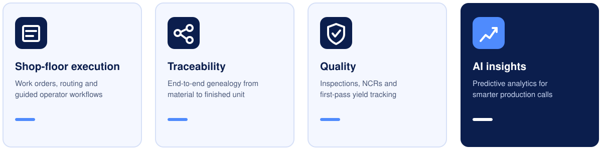
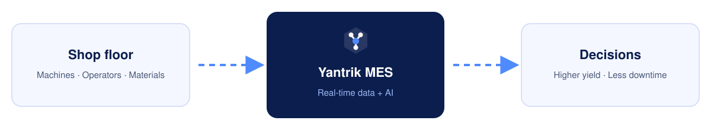

 

## 🏭 What we're building

**Yantrik Infotech** is building an AI-first **Manufacturing Execution System (MES)** that connects the shop floor to real-time decisions, from production planning and work orders to traceability, quality and analytics.

## ⚙️ How it works

## 🎯 Built for

<table>
<tr>
<td align="center" width="33%"><b>🔌 EMS</b> Electronics manufacturing services</td>
<td align="center" width="33%"><b>🚗 Automotive</b> Tier-1 and Tier-2 suppliers</td>
<td align="center" width="33%"><b>🏗️ Discrete manufacturing</b> Assembly and machining lines</td>
</tr>
</table>

## 📫 Get in touch

---

© Yantrik Infotech Pvt. Ltd

